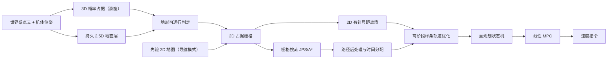

# MA_Nav 导航算法设计

> 状态：草稿（第 0–5 章），待审核。
> 约定：正文给出的参数值为当前典型取值，后附一句取值依据；数值随平台与场景调整，不属于算法本身。
> 【事实】可在代码或配置中直接读到；【推断】由事实推出、代码未直接写明；【待确认】依据不足，需要实测或确认。

---

## 0 设计目标

导航栈输入一路已转到世界系的激光点云和机体位姿，输出底盘速度指令。算法对平台只依赖下列参数：

| 符号 | 含义 |
|---|---|
| $\theta_{max}$ | 可通行的最大地面坡度 |
| $h_{step}$ | 可跨越的最大地面高差（容差） |
| $h_{robot}$ | 车体通过所需的最小净空 |
| $v_{max},\ a_{max}$ | 速度、加速度上限 |
| $d_{safe}$ | 轨迹与障碍的安全距离 |

在这些参数下，算法应满足：

1. **地形正确**：坡度 $\le\theta_{max}$ 的连续地面可通行；高差超过坡度允许值加 $h_{step}$ 的上沿不可通行；净空 $\ge h_{robot}$ 的悬空结构下方可通行。
2. **地图不留持久错误**：位姿短时失准、远距离噪声、动态物体不在地图上留下长期的假障碍或假空闲。
3. **实时**：单帧建图耗时小于传感器周期，规划与控制周期固定。
4. **安全可行**：轨迹与障碍距离 $\ge d_{safe}$，速度、加速度不超过上限。
5. **两种工作方式**：建图模式生成可保存的全局 2D 地图；导航模式在先验地图上叠加实时障碍。

---

## 1 系统架构



| 环节 | 触发 | 说明 |
|---|---|---|
| 感知 | 每帧点云 | 3D 占据 → 地面层 → 地形判定 → 2D 栅格 → 距离场 |
| 规划 | 固定周期（33 ms） | 搜索、后处理、优化；由重规划状态机决定是否重算 |
| 控制 | 固定周期（10 ms） | 跟踪当前轨迹 |

感知只输出 2D 栅格和距离场，高度信息在感知内部消化，规划与控制都在平面上进行。

---

## 2 感知

### 2.1 3D 概率占据与滑窗

**问题**：点云单帧稀疏且有噪声，动态物体会穿过空间。需要一个能累积观测、又能被后续观测修正的 3D 表示，并且内存和单帧代价不随运行距离增长。

**核心思想**：采用 ROG-Map 的概率体素地图。每个体素存占据的对数几率，射线终点命中加分、射线穿过减分；只维护以车为中心的固定大小局部块，车移动时环形缓冲平移。

**建模**：体素 $\mathbf{x}$ 的对数几率 $L(\mathbf{x})$，$\operatorname{logit}(p)=\ln\frac{p}{1-p}$。

$$
L \leftarrow \operatorname{clamp}\!\big(L + n_{hit}\,l_{hit} \text{ 或 } n_{miss}\,l_{miss},\ l_{min},\ l_{max}\big),\quad
l_{\ast}=\operatorname{logit}(p_{\ast})
$$

一帧内某体素既被命中又被穿过时，按命中处理。三态判定：$L<l_{free}$ 为空闲，$L\ge l_{occ}$ 为占据，其余为未知。

- 射线起点取雷达位置，即机体位姿加上雷达安装偏移，而不是机体原点。起点贴地时，掠射射线会把车周地面体素擦成空闲。
- 典型取值 $p_{hit}=0.8$、$p_{miss}=0.45$、$p_{max}=0.93$：饱和体素约 5 次穿过即清除，动态物体离开后残留短。
- 全局坐标到局部槽位用逐轴取模，平移时只重置移出窗口的槽位。

**遗忘**：导航模式下，占据超过 $T_{forget}$ 未被再次命中的体素清为未知；车周半径 $r_{keep}$ 内不遗忘。典型取值 $T_{forget}=2\,$s，$r_{keep}=1.5\,$m，依据是近处处于雷达盲区，遗忘后短时间看不回来。建图模式不遗忘，因为按时间遗忘会误删被遮挡的静态障碍。

**失效边界**：低矮物体在掠射角下只有少量命中；体素分辨率决定可分辨的最小台阶和杆件尺寸。

### 2.2 持久 2.5D 地面层

**问题**：地形判定需要知道"每个位置的地面在哪"。直接取 3D 占据中每列的最低体素不可靠：

- 车周地面在掠射角下会被射线擦掉，列内最低体素变成障碍本身或台面，甚至整列为空；
- 地面一旦被擦掉，3D 地图里就不再有它，邻格高差会被误判为台阶。

**核心思想**：单独维护一张跨帧持久的 2.5D 地面高度图 $G(k)$，$k$ 为 2D 格。它直接用原始点云更新，不随 3D 体素被擦除而消失。更新遵循"易降难升"：地面估计只会被更低的一致观测拉低，被更高的观测抬高需要更多证据，高出太多的视为悬空物。

**状态**：每格记高度 $h$、方差 $\sigma^2$、射线上界 $u$、升降投票，以及标志：真实观测、种子（无观测的推定地面）、走过。存储为以全局格坐标取模的环形缓冲。

**每帧更新**：

```
0  姿态跳变门控：若本帧被门控，只更新足迹后返回
1  每格取本帧最低点 z 及其水平距离 r（只用 r_min < r < r_max 的点，典型 0.5–7.5 m）
2  对每个有观测的格：
     若最低点正下方连续 n_float 个体素为已知空闲 → 悬空下沿，跳过
     σ_m = σ0 + σ1·r
     若格无真实观测：h ← z（种子格上方高出 rise_max 的除外）
     否则 d = z − h，门限 g = max(g_min, 3·sqrt(σ² + σ_m²))
       |d| ≤ g           → 方差加权融合
       d < −g（更低）     → 下降投票；连续 N_drop 帧一致则成为下降候选
       g < d ≤ rise_max   → 上升投票；连续 N_rise 帧一致则上升
       d > rise_max       → 悬空物/车体，忽略
2b 下降候选做邻域一致性确认，通过的才写入
3  射线上界：下行射线经过的未观测格，u ← min(u, 射线高度)；
   射线从已记地面下方穿过、且该格久未命中、且未被走过 → 撤销该格地面
4  足迹：车所在小圆盘标记为走过；无观测时以周围真实地面中位数作种子高度
```

**方差加权融合**：

$$
k=\frac{\sigma^2}{\sigma^2+\sigma_m^2},\qquad h\leftarrow h+k\,d,\qquad \sigma^2\leftarrow(1-k)\,\sigma^2
$$

量测噪声随距离增长，$\sigma_m=\sigma_0+\sigma_1 r$，典型取值 $\sigma_0=0.01\,$m、$\sigma_1=0.003$。依据：远处点的高度离散明显更大。仿真中 6–8 m 处约 5.5% 的点比地面低 5 cm 以上，2–4 m 处不到 1%。

**易降难升**：$N_{drop}=2$，$N_{rise}=3$。地面真实下降（下坡、物体移走）要尽快反映；而"地面升高"更可能是有物体站上来，应交给障碍判据处理。$rise_{max}$ 取 $h_{robot}$：高出地面超过车高的量测不可能是地面。

**姿态跳变门控**：车压过凸起、上下坡的瞬间，位姿与点云的时间对齐会短暂失准，整帧点云发生倾斜。远处地面被记成"坑"，坑周一圈随后被判成上沿障碍。判据是机体 $z$ 轴的帧间夹角：

$$
\Delta\phi_t=\arccos\!\big(\mathbf{z}_t\cdot\mathbf{z}_{t-1}\big)
$$

$\Delta\phi_t>\phi_{jump}$ 时，本帧及其后 $N_{hold}$ 帧不做量测融合和射线上界，只更新足迹。典型取值 $\phi_{jump}=2°$、$N_{hold}=4$。依据：10 Hz 仿真中正常行驶时帧间转角 p90 为 0.4°，失准帧在 2.5°–12° 之间。在同一仿真数据上，门控（当时 $N_{hold}=2$）使坡后平地的假障碍格从 323 降到 0。【待确认】实车帧率和颠簸程度下的阈值。

**下降邻域一致性**：真实的地面下降成片出现，孤立单格下降多为噪声或错配。下降候选需要至少 $N_{sup}$ 个 8 邻格支持，才真正写入：

$$
\#\{\,j\in\mathcal{N}_8(k):\ |h_j-h^{vote}_k|\le 2g_{min}\ \lor\ |h^{vote}_j-h^{vote}_k|\le 2g_{min}\,\}\ \ge N_{sup}
$$

未通过的保留原高度和投票，后续帧继续投票。所有候选先统一判定、再统一写入，结果与遍历顺序无关。典型取值 $N_{sup}=2$。

**射线上界**：下行射线经过的格，地面不可能高于射线。对未观测格记上界 $u$，供下沿判定使用。射线从已记地面下方穿过，说明这块地面已不存在或之前记错；但要求该格近期未被命中、且未被走过，避免掠射噪声误撤销。

**失效边界**：

- 长时间持续的位姿偏差不是"跳变"，门控无法识别；
- 被遮挡、从未观测到的区域只有种子或上界，没有可靠高度；
- 地面层只保存一层高度，桥下、多层结构只能表示最低一层。

### 2.3 地形可通行判定

**问题**：给定 3D 占据和地面高度，决定每个 2D 格是障碍、空闲，还是暂不下结论。要同时处理台阶、坡、墙、悬空杆和隧道，并且只对能真正走到的地方给出空闲。

**核心思想**：以地面层为参考地面，分两类判据：

- **地面判据**：只看地面本身的形状，判出台阶上沿和陡坡；
- **体素判据**：看地面以上的占据体素，判出墙、立柱和净空不足的悬空物。

最后从车所在格出发做可达生长：只有从车能走到的格才写入空闲。

**参考地面**：每格取地面层高度 $G$。地面层缺失时，取列内最低占据体素，并做中值滤波，滤波核典型取 3×3。

**上沿判据**：相邻两格 $i,j$（8 邻域，水平距离 $\delta_{ij}$）之间：

$$
\text{passable}(i,j)\iff |G_i-G_j|\le \tan\theta_{max}\cdot\delta_{ij}+h_{step}
$$

不可跨越时，把高的一侧判为障碍：站在低处是台阶，站在高处是悬崖，挡住高侧格后两个方向都过不去。种子格不参与这一判据，因为它的高度是推定值。典型取值 $\theta_{max}=25°$、$h_{step}=0.03\,$m；容差 $h_{step}$ 用来吸收高度噪声和格子量化。

**陡坡判据**：逐格对 5×5 邻域的地面拟合平面 $z=ax+by+c$：

$$
\text{steep}\iff \sqrt{a^2+b^2}>\tan\theta_{max}\ \land\ \text{RMS}<e_{max}
$$

只有拟合残差小、确实是坡面时才按坡度判；杂乱物体的残差大，交给其他判据。拟合要求至少 12 个有效格。典型取值 $e_{max}=0.02\,$m。

**下沿判据（可选）**：若某格的未观测邻格有射线上界，且上界比本格地面低 $h_{drop}$ 以上，则判为下沿。默认关闭。原因是站在高台上看不见下方的坡，这条判据会把可下的坡也挡住。

**走过的格**：被车走过的格不会因地面判据判成障碍，但仍受体素判据约束。

**体素判据**：对每格，在参考地面以上取最低的占据体素 $z_{low}$，忽略贴地带 $b$ 以内的点：

$$
\text{gap}=z_{low}-G,\qquad
\begin{cases}
\text{无 } z_{low} & \Rightarrow \text{贴地，交给地面判据与可达生长}\\
\text{gap}\ge h_{robot} & \Rightarrow \text{可从下方通过}\\
h_{min}\le\text{gap}<h_{robot}\ \land\ \text{下方已证实为空} & \Rightarrow \text{可从下方通过}\\
\text{其他} & \Rightarrow \text{障碍}
\end{cases}
$$

- 典型取值 $b=0.08\,$m。
- 第三类针对体素量化、杆底混合体素造成的间隙偏小。要求下沿正下方连续若干体素被射线扫为空闲（典型 3 个，允许跳过 1 个未知），并且空闲段一直通到地面。台面、台阶顶面下方是实心，射线进不去，只会是未知，不会被误放行。典型 $h_{min}=0.225\,$m，依据是回放中取 0.18 m 会多放掉台阶边沿。

**悬空列**：若某列最低占据的正下方已证实为空、且空闲段一直通到邻域地面，这一列是悬空结构的下沿，不作为地面来源。否则杆下沿会被当成地面，杆旁格子的高差会被误判成墙。

**可达生长**：

```
从车所在格出发，8 邻域生长：
  不进入障碍格、无地面格
  相邻两格都是真实地面时，要求 passable(i,j)
  （任一侧是种子格时视为可跨越）
只有可达格写入空闲；不可达的格保持原状态
```

可达约束保证空闲证据只来自连通、可走的地面。例如高台台面、坑底这类"看着平但上不去"的区域，不会被当成通路。

**空列空闲证据**：某格本帧没有任何占据体素时，上面的判据无法下结论，以前写入的障碍会一直留着。补一条规则：该格可达、8 邻域本帧没有障碍、且从邻域参考地面到 $h_{robot}$ 高度这一段已被射线证实为空，则给空闲证据。

**失效边界**：

- 一次判定只用 8 邻域，宽度小于一格的台阶边沿会被量化掉；
- $\theta_{max}$ 和 $h_{step}$ 是全局常数，不区分上坡和下坡；
- 负障碍（坑、悬崖下方）主要靠下沿判据，默认关闭时只能靠"不可达"保守处理。

### 2.4 建图模式与导航模式

**问题**：建图要得到完整、干净、可保存的静态地图；导航时静态结构已知，需要的是对动态障碍的快速响应和及时清除。两种需求对"记多久"的要求相反。

**建图模式**：2D 地图持久累积。

- 障碍证据立即写入。
- 空闲证据需要连续 $N_{clear}$ 帧才清除已有障碍，防止细杆、网格的单帧漏检被清掉。典型 $N_{clear}=2$。
- 窗口外和无观测的格保持原值。
- 3D 层不遗忘。

**导航模式**：最终地图 = 先验静态层 $\lor$ 动态层。

$$
M = \max(M_{prior},\ M_{dyn})
$$

- 动态层每帧按本帧判定结果重建。
- 3D 层按 2.1 节的规则遗忘。
- 先验层兜底静态结构；动态障碍离开后，2D 上立即消失，3D 上 $T_{forget}$ 后消失。

**失效边界**：

- 先验地图与实时位姿未对齐时，两层叠加会产生重影；
- 先验图中已不存在的障碍，导航模式无法清除。

### 2.5 2D 有符号距离场

**问题**：规划需要的不只是"碰没碰"，还要"离障碍多远"以及往哪个方向远离，以便把避障写成可微代价。

**核心思想**：对 2D 占据栅格做精确欧氏距离变换，得到有符号距离 $d(\mathbf{p})$：自由区为正，障碍内部为负。距离变换采用按行、按列分离的一维下包络算法（Felzenszwalb–Huttenlocher），复杂度与格数成线性。

$$
d(\mathbf{p})=
\begin{cases}
\ \ \min_{\mathbf{q}\in O}\|\mathbf{p}-\mathbf{q}\|, & \mathbf{p}\notin O\\
-\min_{\mathbf{q}\notin O}\|\mathbf{p}-\mathbf{q}\|, & \mathbf{p}\in O
\end{cases}
$$

查询时以最近格心为中心，在 3×3 邻域上做二次插值，梯度 $\nabla d$ 由插值权重解析求导得到，保证梯度连续；贴近地图边界时退回双线性插值。

- **硬阈值**：搜索和碰撞检查要求 $d\ge d_{safe}$。
- **软约束**：轨迹优化把 $\max(0,d_{safe}-d)$ 作为惩罚代价。

典型取值 $d_{safe}=0.35\,$m。

**为什么用 2D**：底盘在平面上运动，高度方向的可通行性已在 2.3 节转化为 2D 占据，不需要三维距离场。

**失效边界**：

- 距离场只反映 2D 栅格。栅格中的漏检和误检会直接传给规划；
- 分辨率 $r$ 带来最大 $r/\sqrt2$ 的距离误差。

---

## 3 规划

规划链路每个周期按以下顺序执行：重规划状态机判断是否需要重算 → 起终点安全化 → 栅格搜索 → 路径后处理与时间分配 → 两阶段样条优化。规划结果是一条带时间的 $(x,y)$ 五次样条，前面可能拼接一段匀减速刹车段。

### 3.1 栅格搜索

**问题**：在 2D 栅格上快速找到一条与障碍保持 $d_{safe}$ 的无碰撞路径，为后续优化提供拓扑和初值。

**核心思想**：搜索空间是"距离场 $\ge d_{safe}$ 的格"，即用距离场把车体膨胀成点，然后做 8 连通最短路搜索。在无权重的均匀栅格上，JPS（Jump Point Search）通过对称性剪枝跳过大量等价路径，只展开跳点，得到与 A* 相同的最优解，但展开节点少得多 [5]。A* 作为对照保留。

**建模**：

- 可通行：$\text{free}(c)\iff d(c)\ge d_{safe}$。按需计算并缓存。
- 步长代价：直线步为 1，对角步为 $\sqrt2$（单位为格）。
- 启发函数用 octile 距离：$h=\max(|\Delta x|,|\Delta y|)+(\sqrt2-1)\min(|\Delta x|,|\Delta y|)$。它在 8 连通栅格上是一致的，节点展开后不再重开。
- JPS 的跳跃规则：沿当前方向前进，直到遇到终点、出现强制邻居，或者对角前进时任一正交分量能找到跳点。展开时按来向剪枝：起点展开 8 个方向，直线来向展开 3 个，对角来向展开 3 个自然方向加强制方向。

**起终点安全化**：起点或终点落在 $d<d_{safe}$ 区域时，沿距离场梯度外推：

$$
\mathbf{p}\leftarrow\mathbf{p}+\big(d_{safe}-d(\mathbf{p})+\epsilon\big)\,\frac{\nabla d}{\|\nabla d\|}
$$

迭代直到 $d\ge d_{safe}$，或累计位移超过上限（典型 1.5 m，$\epsilon=0.05\,$m）。外推仍失败时，在起点附近环形搜索最近的自由格。车被动态障碍贴近、或目标点点在墙边时，仍然能规划。

**失效边界**：

- 搜索不含运动学，路径在转角处是折线，需要后续处理；
- 窄于 $2d_{safe}$ 的通道在搜索层就不可达，与优化层的软约束无关。

### 3.2 路径后处理与时间分配

**问题**：栅格路径点多、方向锯齿，不带时间。优化器需要一组稀疏、均匀、带合理时间的参考点作为初值，而且初值的时间分配直接决定优化后的速度是否合理。

**核心思想**：

1. 先用视线检查剪去冗余点；
2. 再把转角折算成等效路程，把"转弯要慢"放进速度剖面；
3. 最后按固定时间间隔重采样，供优化器使用。

**流程**：

```
1 视线剪枝：贪心保留拐点，相邻保留点之间的连线（Bresenham 栅格化）上所有格 d ≥ d_safe
2 状态采样：每段计算航向 θ_i = atan2(Δy, Δx) 与转角 Δθ_i
3 密采样：每段按 δ 细分，位置线性插值，航向在段内线性过渡
4 等效路程：Δs_eq = Δs + w_r·|Δθ|
5 速度剖面：前向、后向加速度锥 + 积分得到时间
6 隧道入口前限速（需要折叠云台通过的区域）
7 等时间重采样：n = clamp(round(T/Δt_0), n_min, n_max)，在 t_k = kT/n 处插值
```

**速度剖面**：在等效路程上做前后两遍。$v_0$ 为起点速度（来自热启动），$v_{end}=0$：

$$
v_i\leftarrow\min\!\Big(v_{max},\ \sqrt{v_{i-1}^2+2a_{max}\Delta s_{eq,i}},\ \sqrt{v_{i+1}^2+2a_{max}\Delta s_{eq,i+1}}\Big),\qquad
t_i=t_{i-1}+\frac{2\Delta s_{eq,i}}{v_{i-1}+v_i}
$$

因为在等效路程上积分，转角大的地方速度低、耗时长，相当于给优化器一个"弯道减速"的时间初值。典型取值：

- $\delta=0.05\,$m，取栅格分辨率；
- $w_r=1.0\,$m/rad；
- $\Delta t_0=0.4\,$s，$n\in[5,16]$。段数下限保证短轨迹有足够的优化自由度，上限控制优化变量的规模。

**隧道入口限速**：车需要在隧道前折叠云台。入口前的一段距离内把速度上限压到 $v_{fold}$：

$$
d_{prep}=v_{fold}\,T_{fold}+d_{margin}
$$

**失效边界**：

- 剪枝只看几何长度，不考虑转角；
- 段数有上限，长轨迹的段时长会超过 $\Delta t_0$，单段跨度变大；
- 等效路程是经验折算，转角很大时时间偏保守。哈工大（威海）报告提到，固定时间间隔的初值在急弯处会导致过冲 [8]。3.3 节的均值约束用来缓解这一问题。

### 3.3 两阶段样条轨迹优化

**问题**：把参考点优化成一条光滑、动力学可行、与障碍保持安全距离的连续轨迹。单次优化中，避障、动力学和时间几个目标相互拉扯：在狭窄处，ESDF 梯度会把控制点推离通道并拉长段时长，产生不合理的速度。

**核心思想**：

- **表示**：轨迹用分段五次多项式表示，参考 MINCO [6]。给定经过点和段时长后，系数可以闭式求出（最小 jerk），所以优化变量只有内部经过点和段时长，维度低。
- **约束处理**：避障和动力学都写成软约束惩罚，用 L-BFGS 求解。
- **两阶段**：参考中科大的两步优化 [7]，分两次进行。
  - 第一阶段做"形状优化"：避障权重低，加段时长均值约束，保持前端等时间间隔的性质，先得到稳定的轨迹形状；
  - 第二阶段做"严格优化"：以第一阶段的结果为初值，提高避障和动力学权重，并改造避障梯度，得到可行轨迹。

**决策变量**：内部经过点 $\{\mathbf{q}_i\}_{i=1}^{N-1}$ 和段时长 $\{T_i\}_{i=1}^{N}$。起终点的位置、速度、加速度固定。为保证 $T_i>0$ 且映射光滑，用无约束变量 $\tau_i$ 表示时长：

$$
T(\tau)=\begin{cases}\tfrac12\tau^2+\tau+1,&\tau>0\\[2pt] \big(\tfrac12\tau^2-\tau+1\big)^{-1},&\tau\le0\end{cases}
$$

**目标函数**：

$$
J=\rho\!\int\!\|\dddot{\mathbf{p}}\|^2dt\;+\;J_T\;+\;\sum_{i}\sum_{k=0}^{K}\omega_k\frac{T_i}{K}\Big[w_o\,\mathcal{L}\big(d_{safe}-d(\mathbf{p})\big)+w_v\,\mathcal{L}\big(\|\mathbf{v}\|^2-v_{max}^2\big)+w_a\,\mathcal{L}\big(\|\mathbf{a}\|^2-a_{max}^2\big)\Big]
$$

- 能量项有闭式解析解；
- 约束项在每段 $K+1$ 个等时间点上，按梯形权重 $\omega_k$ 求积；
- 惩罚函数 $\mathcal{L}$ 是 C² 平滑的 L1：$x\le0$ 时为 0；$0<x<\varepsilon$ 时为四次过渡；$x\ge\varepsilon$ 时为 $x-\varepsilon/2$。
- 时间项：

$$
J_T=w_T\sum T_i+w_{min}\sum\big[\min(0,T_i-T_{min})\big]^2+w_{mean}\sum\big[\text{dist}(T_i,[\alpha\bar T,\beta\bar T])\big]^2
$$

最后一项是段时长均值约束，$\bar T$ 为平均段时长，只在第一阶段启用。典型取值 $\alpha=0.9$、$\beta=1.1$，参考 [7]。

**第二阶段的避障梯度**：在狭窄处，完整的 $\nabla d$ 有沿速度方向的分量，会推动段时长和经过点沿轨迹方向滑动。第二阶段只在违反安全距离（$d<d_{safe}$）时介入，并对梯度做三步处理：

1. 去掉沿速度方向的切向分量，保留横向分量 $\mathbf{g}_\perp$；
2. 沿 $\mathbf{g}_\perp$ 前探一个栅格，用差分估计"往外走一步距离能增加多少"；
3. 差分 $<0.5$ 说明处在两侧都有障碍的势谷中，梯度模长取 $\sqrt{\|\mathbf{g}_\perp\|}$；否则把梯度归一化。

代价始终用真实违反量 $\mathcal{L}(d_{safe}-d)$，只调整梯度，保证代价与梯度的变化趋势一致。之前用"替换代价"的方式处理势谷时，代价在阈值两侧跳变，线搜索频繁失败，薄墙处的惩罚也被压低，压不住时间项。

**两阶段典型权重**：

| 项 | 第一阶段 | 第二阶段 |
|---|---|---|
| 能量 $\rho$ | 10 | 5 |
| 时间 $w_T$ | 80 | 20 |
| 均值 $w_{mean}$ | 40 | 0 |
| 避障 $w_o$ | 800 | 8000 |
| 速度/加速度 $w_v,w_a$ | 5 | 40 |
| 迭代上限 | 100 | 200 |

比例按"先形状、后可行"分工：第二阶段避障约 ×10，动力学约 ×8。具体数值是经验调参，没有推导依据【待确认】。

**失败处理**：第一阶段失败则本次规划失败，继续沿用上一条轨迹；第二阶段失败则输出第一阶段的结果。

**失效边界**：

- 避障是软约束，且只在求积点上检查，采样点之间没有安全保证；
- 两阶段只调权重，不改变拓扑。前端路径质量差时，优化无法自救；
- 当前只优化 $(x,y)$，航向不参与。

### 3.4 重规划策略

**问题**：地图在变化，车会偏离轨迹，目标也会移动。需要决定何时重算，以及从什么状态起算。起算状态不连续时，速度指令会跳变。

**触发条件**（每个规划周期检查，任一满足即重规划）：

1. 目标点在任一轴上变化超过 $\Delta g$，典型 0.2 m；
2. 当前参考路径上有点的距离场 $d<d_{hard}$，即新障碍挡住了路；
3. 车到参考路径的横向偏差超过 $e_{lat}$，典型 0.5 m；
4. 当前没有有效轨迹，或上次规划失败。

距目标小于 $r_{goal}$（典型 0.3 m）时判为到达，停止规划。

**起点状态（热启动）**：起点位置取当前定位结果。速度和加速度不用里程计测量值，而从上一条轨迹上取：

$$
t^\*=\arg\min_{t}\|\mathbf{p}_{prev}(t)-\mathbf{p}_{robot}\|,\qquad \mathbf{v}_0=\dot{\mathbf{p}}_{prev}(t^\*),\ \mathbf{a}_0=\ddot{\mathbf{p}}_{prev}(t^\*)
$$

搜索步长典型 0.02 s。这样处理有两个原因，与哈工大（威海）报告的分析一致 [8]：

- 测量速度带噪声，而且控制必然有误差，每次重规划的边界值不会落在期望的连续轨迹上；
- 测量速度作为硬边界，会使起点附近的轨迹出现圆弧和扭曲。

**方向一致性**：设新路径首段方向为 $\hat{\mathbf{d}}$。

- $\mathbf{v}_0\cdot\hat{\mathbf{d}}<0$（夹角大于 90°）：走反向分支，见下文；
- 夹角在 60°–90° 之间：只保留 $\mathbf{v}_0$ 沿 $\hat{\mathbf{d}}$ 的分量，令 $\mathbf{a}_0=0$；
- 起点被安全外推过：速度投影到 $\hat{\mathbf{d}}$（负值取 0），令 $\mathbf{a}_0=0$。

**反向重规划刹车段**：目标在速度反方向时，样条必须在边界速度与路径方向相反的条件下起步，会产生打结的轨迹。改为先沿当前速度方向匀减速刹停，再从刹停点以零速重新规划。刹车距离：

$$
L_{nom}=\frac{\|\mathbf{v}_0\|^2}{2a_b}
$$

沿 $\hat{\mathbf{v}}_0$ 方向做射线检查，阈值取 $\min\big(d_{safe},\,0.85\,d(\mathbf{p}_0)\big)$。遇到第一个低于阈值的点时，可用距离记为 $L_{geo}$。所需减速度：

$$
a=\begin{cases}a_b,&L_{geo}\ge L_{nom}\\[2pt] \|\mathbf{v}_0\|^2/(2L_{geo}),&\text{否则}\end{cases}
$$

$a$ 超过上限 $a_{b,max}$ 时，按急停处理：控制端直接下发零速。刹车段

$$
\mathbf{p}(t)=\mathbf{p}_0+\mathbf{v}_0t-\tfrac12a\hat{\mathbf{v}}_0t^2,\quad t\in[0,\|\mathbf{v}_0\|/a]
$$

拼在样条前面，控制端在统一的时间轴上跟踪两段。速度低于 0.2 m/s 时不生成刹车段，直接零速起步。典型取值 $a_b=6$、$a_{b,max}=10\,$m/s²，依据是底盘加减速能力强；这两个值应不超过底盘能力和 MPC 的控制限幅。

**失效边界**：

- 碰撞复检只查离散参考路径，不查样条本身；
- 规划失败时继续跟踪旧轨迹，没有减速兜底，连续失败 20 s 才报失败。

---

## 4 控制

### 4.1 线性 MPC 轨迹跟踪

**问题**：在固定控制周期内，跟踪一条带时间的连续轨迹，同时满足速度和加速度限制，并且对短时偏差有前瞻性的修正。

**核心思想**：全向底盘在平面上近似为两个独立的双积分器。取世界系位置和速度为状态、加速度为控制，模型是线性的，问题可以写成凸 QP，在每个控制周期求一次。参考状态直接从样条解析采样，包括位置、速度和加速度。加速度作为前馈。

**模型**：$\mathbf{x}=[x,y,v_x,v_y]^\top$，$\mathbf{u}=[a_x,a_y]^\top$，前向欧拉离散：

$$
\mathbf{x}_{k+1}=\begin{bmatrix}I&\Delta t\,I\\0&I\end{bmatrix}\mathbf{x}_k+\begin{bmatrix}0\\\Delta t\,I\end{bmatrix}\mathbf{u}_k
$$

**目标函数**：

$$
\min_{\mathbf{x},\mathbf{u}}\ \sum_{k=0}^{N-1}\|\mathbf{x}_k-\mathbf{r}_k\|_Q^2+\|\mathbf{x}_N-\mathbf{r}_N\|_{Q_N}^2+\sum_{k=0}^{N-1}\|\mathbf{u}_k-\mathbf{a}^{ref}_k\|_R^2+\sum_{k=1}^{N-1}\|\mathbf{u}_k-\mathbf{u}_{k-1}\|_{R_d}^2
$$

约束为 $|v_x|,|v_y|\le v_{max}$ 与 $|a_x|,|a_y|\le a_{max}$，全部是硬约束。用 OSQP 求解，开启热启动。海森矩阵和约束矩阵只构建一次，每个周期只更新线性项和上下界。

**参考时间对齐**：参考时刻不用墙钟时间，而是用跟踪游标 $t_{track}$。

- 每个周期在 $[t_{track}-0.3,\ t_{track}+3]$ 区间内，按位置搜索车在轨迹上的最近点，更新 $t_{track}$；
- 刹车段内则按实际经过的时间推进；
- 参考序列为 $\mathbf{r}_k=\text{sample}(t_{track}+k\Delta t)$，超出轨迹末端的部分取终点状态。

【推断】按位置对齐，车落后于轨迹时参考不会持续"跑远"，避免出现越追越快的现象。

**输出**：下发预测第一步的速度 $\mathbf{v}_1=\mathbf{v}_0+\mathbf{u}_0\Delta t$，再用定位航向把世界系速度旋转到车体系。航向不由 MPC 控制，可以与平移解耦，例如小陀螺状态下平移仍按世界系方向描述。

典型取值：

- $N=20$、$\Delta t=0.05\,$s，预测时域 1 s。【推断】时域长度恰好等于以 $a_{max}$ 从 $v_{max}$ 刹停所需的时间。
- $Q=\text{diag}(30,30,1,1)$，$Q_N=\text{diag}(40,40,2,2)$：重位置、轻速度，以贴合轨迹为主。
- $R=R_d=0.05$。
- 控制周期 10 ms。

**失效边界**：

- 状态中的速度取上一周期的指令速度，而不是测量速度，对执行偏差没有直接反馈；
- 速度按轴分别限幅，合速度最大可达 $\sqrt2\,v_{max}$；
- 刹车段的参考减速度大于 $a_{max}$ 时，MPC 跟不上刹车参考；
- 求解失败时本周期不输出指令，由底盘超时策略兜底。

---

## 5 局限与改进方向

### 5.1 感知

| 局限 | 改进方向 |
|---|---|
| 位姿持续偏差（不是跳变）时，地面层会被持续写错 | 引入定位协方差或点云-地图配准残差作为门控信号 |
| 地面层只有一层，桥下、多层结构只能表示最低层 | 每格多层高度（多层 2.5D） |
| 负障碍依赖下沿判据，默认关闭 | 结合射线上界与可见性，区分"看不见"和"确实是坑" |
| $\theta_{max}$、$h_{step}$ 全局固定，不区分上下坡 | 按行进方向区分上坡和下坡阈值 |
| 动态障碍只靠遗忘清除 | 动态点分割，北理工报告列为后续方向 [9] |

### 5.2 规划

| 局限 | 改进方向 |
|---|---|
| 避障是软约束，求积点之间没有安全保证 | 输出前对样条做独立安全检查（速度、加速度、ESDF 距离），不合格则回退，参考北理工的 Safety Gate [9]；或沿路径构建凸走廊作为硬约束 |
| 搜索不含运动学，急弯处靠等效路程补偿 | 前端时间分配改用一次放松约束的优化（中科大"思路二"）[7] |
| 规划失败时没有减速兜底 | 失败超过一定时间后，沿当前轨迹平滑减速 |
| 航向不参与优化 | 启用 $(x,y,\psi)$ 联合优化，并加航向速率和角加速度约束 |
| 重规划没有最小间隔，热启动没有连续性阈值 | 加入最小间隔；车离旧轨迹过远时退回零速冷启动 |

### 5.3 控制

| 局限 | 改进方向 |
|---|---|
| 速度状态开环，对执行偏差无反馈 | 用测量速度或其滤波值作为初始状态 |
| 没有补偿控制延迟 | 取预测时域中延迟时刻的速度作为指令，参考中科大 [7] |
| 不控制航向 | SE(2) MPC，按通道宽度切换航向策略 [7][9] |
| 速度按轴限幅 | 用多面体近似圆形速度约束 |

---

## 参考文献

【待核对：引用前逐条核对标题、作者与年份】

1. ROG-Map：滑窗概率体素地图。
2. Felzenszwalb, Huttenlocher. Distance Transforms of Sampled Functions.
3. Fankhauser 等. 2.5D 高程建图（elevation mapping）。
4. OSQP：基于 ADMM 的凸二次规划求解器。
5. Harabor, Grastien. Online Graph Pruning for Pathfinding on Grid Maps（JPS）.
6. Wang 等. MINCO / GCOPTER：几何约束下的多旋翼轨迹优化。
7. 中国科学技术大学 RoboMaster 2025 哨兵技术报告（`docs/nav/开源参考/RM2025中科大导航.md`）。
8. 哈尔滨工业大学（威海）RoboMaster 2026 哨兵导航方案（`docs/nav/开源参考/RM2026哈工大(威海)哨兵导航方案.md`）。
9. 北京理工大学追梦战队 RoboMaster 2026 哨兵导航（`docs/nav/开源参考/RM2026北京理工大学追梦战队哨兵导航.md`）。
